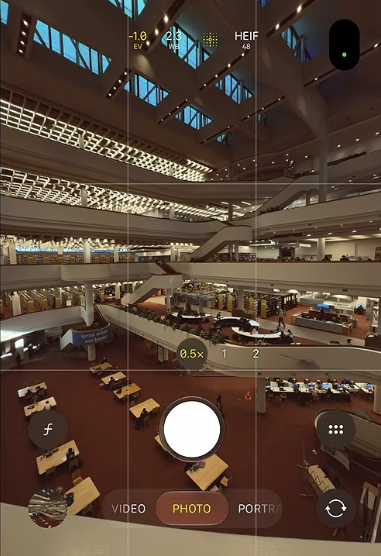
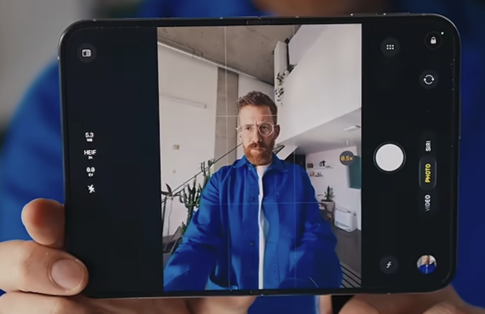

# iPhone Duo camera — user-provided visual references

Received 2026-11-01. Archived for future design work only; no Recon layout or implementation changes accompany these references.

## States and observations

- **Cover:** the user identifies `cover.png` as the cover-screen camera UI. It shows a tall preview with controls layered over its lower portion.
- **Unfolded without rotation:** the user identifies `unfolded-without-rotation.png` as the device opened without rotating it. The visible window is wide, while the central camera preview remains tall and upright; controls occupy side regions.
- **Design lesson:** unfolding can change window proportions without changing upright camera-frame direction. Window layout and camera framing must remain independent.

Device identification and the no-rotation transition are supplied by the user. The images show different scenes, so they are references for the stated states rather than a recorded continuous transition. They do not establish exact sensor orientation, output aspect ratio, usable dp dimensions, camera facing or mirroring policy.

## Original assets

Original PNG bytes are preserved without cropping, scaling or annotation. Dimensions below describe the supplied image files, not device display specifications.

| File | Image pixels | SHA-256 |
| --- | --- | --- |
| [cover.png](cover.png) | 381 × 556 | `23def6cb7a45dd9d843bf224dad9c89beb5adbe8bc28fed1b10483c0553b5a77` |
| [unfolded-without-rotation.png](unfolded-without-rotation.png) | 1078 × 699 | `6f2368cf1604c5d39062bbb0d3bab1d400937a0ea32f544b4bcd9f31d794fac4` |

## Preview

### Cover

### Unfolded without rotation

Related: [archived Android orientation investigation](../../archive/foldable-camera-orientation-ux-review.md). These new references do not expand the current Android prototype scope to iOS.
