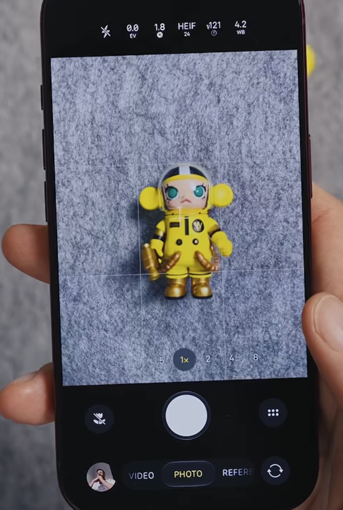

# Traditional iPhone camera — user-provided visual reference

Received 2026-11-01. The user identifies this image as a typical traditional iPhone camera UI. Saved for future reference only.

## Visible layout

- Tall, upright preview occupying nearly the full display width.
- Camera settings in a dark region above the preview.
- Grid and zoom choices overlaid on the preview; 1× selected.
- Large centered shutter in a dark region below the preview.
- Gallery thumbnail, mode selector and camera-switch control along the bottom.

This is a photograph of the device, with perspective distortion. Image dimensions are not device specifications; exact model, OS version, capture ratio and usable dp dimensions are not established here.

## Original asset

[portrait-camera.png](portrait-camera.png) — 970 × 1440 image pixels. Original bytes preserved without cropping, resizing or annotation.

SHA-256: `a80e2cc1f3d73dd5e34b63b3124dd5ed511e560693573f55da5cf3847ee6664f`

Related: [iPhone Duo cover and unfolded references](../iphone-duo-camera/README.md).

No Recon design or implementation changes accompany this reference.
